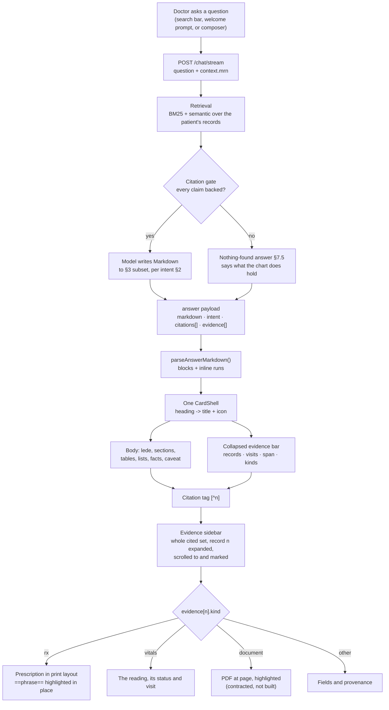

# Dr. Copilot — answer contract

How the clinical archive should shape an answer so the portal can render it.

The portal draws **one card**. Not a card per question type, not a catalogue
lookup — one boxy card, the same one every other Copilot output uses. What
changes inside it is the content, and the content arrives as **Markdown**.

That is the whole idea: the model decides *what* to say and *how it is
structured*; the portal decides how structure *looks*. Neither has to know
about the other's internals, and a new kind of question needs no portal
release — only a model that emits the right Markdown.

This document is the contract between the two.

---

## 1. The envelope

`/chat/stream` already returns an `answer` object. Two fields are added; the
rest is unchanged.

```jsonc
{
  "markdown": "# Medications on record\n\n> Three prescriptions...",
  "intent": "medications",          // see §2. Optional; the portal can infer it.
  "segments": [ ... ],              // kept for backward compatibility
  "citations": [ ... ],             // unchanged
  "evidence":  [ ... ],             // extended, see §6
  "retrieval": { ... }              // unchanged
}
```

When `markdown` is absent the portal falls back to `segments`, so nothing
breaks while the model is being taught this format.

---

## 2. Question packages

Every question the archive can answer falls into one of these. The package
decides the heading's icon, the sections the model should reach for, and what
counts as the primary datum worth highlighting.

| `intent` | Question sounds like | Sections to emit | Highlight |
|---|---|---|---|
| `medications` | "What was prescribed?", "Is she still on metformin?" | Current, Past, Changes | drug name + dose |
| `vitals` | "Latest BP?", "Weight trend?" | Latest, Trend | the measured value |
| `labs` | "What labs are on file?", "HbA1c?" | Results, Flagged | value + unit |
| `diagnosis` | "What conditions are recorded?" | Active, Resolved | condition name |
| `history` | "What changed since last visit?" | Timeline, Changes | what changed, and when |
| `advice` | "What was she counselled on?" | Advice, Follow-up | the instruction |
| `allergy` | "Any documented reaction?" | Reactions, Allergy list | drug + reaction |
| `procedure` | "Any surgery on record?" | Procedures | procedure + date |
| `documents` | "What reports are on file?" | Documents | document type + date |
| `unknown` | anything else | free | — |

`unknown` is not a failure state. It renders the same card with a generic
icon, and is the correct answer whenever the model is not confident.

---

## 3. The Markdown subset

Only these constructs are rendered. Anything else is shown as plain text — the
renderer never fails on unexpected Markdown, it just stops decorating it.

### Heading — required, exactly one, first line

```markdown
# Medications on record
```

Becomes the card's title. The icon is chosen from the heading and `intent`, so
write headings that name the clinical thing, not the query:

- Good: `# Blood pressure on record`, `# What changed since 12 May`
- Bad: `# Answer`, `# Results for your query`

### Lede — optional, one line, directly under the heading

```markdown
> Three prescriptions, all the same drug, unchanged across two visits.
```

One sentence that answers the question before any detail. If a doctor reads
only this line, they should have the answer.

### Sections

```markdown
## Current
```

Rendered as the product's section bar with an icon. Use the section names from
§2 where they fit — those have icons mapped. Unmapped names still render, with
a neutral mark.

### Tables — for anything with more than one row and more than one attribute

```markdown
| Drug | Dose | Duration | Started |
|---|---|---|---|
| **URSODEOXYCHOLIC ACID 300 MG** [^1] | 1 tab | 15 days | 24 Apr 2026 |
| **URSODEOXYCHOLIC ACID 300 MG** [^2] | 1 tab | 1 month | 12 May 2026 |
```

First column is the subject. Put the citation in the cell it belongs to, not
at the end of the row.

### Lists — for findings, changes and anything sequential

```markdown
- Started on ==metformin 500 mg== once daily after food [^1]
- Increased to **500 mg twice daily** at the February review [^2]
```

### Facts — for a handful of labelled values

```markdown
::: facts
Recorded: 12 May 2026
Status: final
Visit: OPD:9277235
:::
```

Rendered as chips. Use for four or fewer values; beyond that, use a table.

### Caveat — for what the record does *not* say

```markdown
!> No reference range is stored for these values, so none is shown.
```

This is not decoration. Every limitation the model is aware of belongs here,
in the model's own words. A silently missing caveat is worse than a wrong
number, because the doctor cannot see that it is missing.

---

## 4. Highlighting

Two marks, and they mean different things. Do not use them interchangeably.

| Syntax | Meaning | Rendered as |
|---|---|---|
| `**text**` | The primary datum — the value that answers the question | Ink, semibold |
| `==text==` | The matched phrase — the words that were searched for, as they appear in the record | Yellow highlight |

`==` is doing double duty on purpose: it marks the phrase in the answer, **and
it is the phrase the portal highlights inside the source document** when the
citation is opened. If the model writes `==metformin 500 mg==`, the doctor
clicks the citation and sees exactly those words lit up in the prescription
they wrote. That is the whole trust mechanism, and it only works if `==`
contains text that is genuinely present in the source.

Rules:
- `==` must contain a **verbatim substring of the source record**. Never a
  paraphrase, never a normalised form.
- One `**` per row or bullet. Bolding everything bolds nothing.
- Do not bold or mark inside a caveat.

---

## 5. Citations

```markdown
[^1]
```

A footnote marker, one-indexed into `citations[]`. It renders as a small blue
link tag beside the text it belongs to.

- Place it immediately after the claim it supports, inside the cell or bullet.
- Several markers may follow one claim: `[^1] [^2]`.
- Every factual claim carries one. A sentence with no citation reads, to the
  portal and to the doctor, as something the archive did not find.

---

## 6. Evidence

Each entry in `evidence[]` gains a `kind`, and the portal renders it
accordingly. Two kinds; only the first is built today.

### `kind: "rx"` — a prescription written after a consultation

This is the common case, and the one that earns trust: the doctor is being
shown something they wrote themselves.

```jsonc
{
  "kind": "rx",
  "source_path": "opd.med.17655665",
  "visit": {
    "id": "OPD:9058284",
    "date": "2026-04-24",
    "doctor": "Dr Sheela BR",
    "speciality": "Paediatrics",
    "clinic": "Apex Ortho Clinic"
  },
  "highlight": "URSODEOXYCHOLIC ACID-300MG",   // matches the ==...== in the answer
  "rx": {
    "symptoms":      ["Restless", "Cold", "Cough", "Fever"],
    "examination":   ["PER ABDOMEN EXAMINATION"],
    "diagnosis":     ["Acute viral illness"],
    "medications":   [
      { "name": "URSODEOXYCHOLIC ACID-300MG", "dose": "1 tab", "frequency": "0-0-1",
        "duration": "15 Day(s)", "notes": "After food" }
    ],
    "investigations":["CBC"],
    "advice":        ["Plenty of fluids"],
    "followUp":      "After 15 days"
  }
}
```

The portal renders `rx` in the clinic's own prescription layout — the same
sections, the same order as the printed sheet — and highlights every
occurrence of `highlight` inside it. The citation's own tag reads
**which visit, on which date**, because that is how a doctor remembers a
prescription.

### `kind: "document"` — an uploaded PDF or report

Reserved. The portal renders a placeholder naming the document and its date.
Page-level highlighting inside a PDF is a later piece of work; the contract
field is `page` plus the same `highlight` string, so nothing has to change
when it lands.

```jsonc
{ "kind": "document", "title": "CBC report", "date": "2026-05-12",
  "page": 1, "highlight": "Eosinophils 34 %", "url": "..." }
```

### Anything else

An evidence row with no `kind`, or an unknown one, falls back to the plain
field-and-provenance view that exists today. Nothing is dropped.

---

## 7. Worked examples

These are the answers the portal is built to render. They are written the way
the model should write them, including the awkward cases - because the awkward
cases are where an answer stops being trustworthy.

### 7.1 Medications

*"What medications were recorded?"*

```markdown
# Medications on record

> One drug across two visits, at the same dose, with the course extended in May.

## Current

| Drug | Dose | Duration | Started |
|---|---|---|---|
| **==URSODEOXYCHOLIC ACID-300MG==** [^1] | 1 tab | 15 Day(s) | 24 Apr 2026 |
| **==URSODEOXYCHOLIC ACID-300MG==** [^2] | 1 tab | 1 Month(s) | 12 May 2026 |

## Changes

- The course was extended from ==15 Day(s)== to ==1 Month(s)== on **12 May 2026** [^2]
- No change to dose or frequency across either visit [^1] [^2]

!> Only prescriptions written in this clinic are searchable. Medication the
patient takes from elsewhere will not appear here.
```

Clicking `[^1]` opens the 24 Apr prescription, in print layout, with
`URSODEOXYCHOLIC ACID-300MG` lit up in its medication row.

### 7.2 Vitals

*"What was the latest recorded blood pressure?"*

```markdown
# Blood pressure on record

> **106/77 mmHg**, recorded at the 12 May 2026 visit. One reading only.

## Latest

| Reading | Value | Recorded |
|---|---|---|
| ==Systolic blood pressure== [^1] | **106 mmHg** | 12 May 2026 |
| ==Diastolic blood pressure== [^2] | **77 mmHg** | 12 May 2026 |

!> No reference range is stored against these readings, so nothing is marked
high or low. A single reading is not a trend.
```

Note what is *not* claimed. The archive returns no reference range on any
resource, so the model must not call a value normal, high or low, and must not
imply a trend from one reading. The caveat says both.

### 7.3 Labs, when there are none

*"What lab results are on file?"*

This is the common case in the current archive, and the one most likely to be
answered badly. There are no lab *results*; there are investigations that were
*advised*, inside consultation notes. Those are different things, and the
answer must not blur them.

```markdown
# No lab results on file

> No investigation results are stored for this patient. Three tests were
> advised across two visits, but no result has been recorded against them.

## Advised, no result recorded

| Test | Advised on | Visit |
|---|---|---|
| ==CBC== [^1] | 24 Apr 2026 | OPD:9058284 |
| ==LFT== [^1] | 24 Apr 2026 | OPD:9058284 |
| ==HBsAG== [^2] | 12 May 2026 | OPD:9277235 |

!> These were advised in the consultation note. Results are not in the
archive - they may exist on paper, in the lab's own system, or not yet be
back.
```

An empty answer that explains *why* it is empty, and what does exist instead,
is a useful answer. "The clinical archive does not contain enough recorded
evidence to answer that question" is not: it tells the doctor nothing about
whether to go looking elsewhere.

### 7.4 What changed

*"What changed across this patient's recent records?"*

The hardest one, and currently the worst. A change answer must compare two
points in time and name the difference. Listing every record with a date in
front of it is not a change answer - it is the retrieval log, and the doctor
can already see the dates.

**Wrong:**

```markdown
- **2026-04-24** — Composition [^5]
- **2026-04-24** — medical_history [^7]
- **Undated** — StructuredQuery [^1]
```

That fails three ways: it exposes internal resource kinds, it lists records
rather than changes, and `StructuredQuery` rows are retrieval mechanics that
should never reach a doctor at all.

**Right:**

```markdown
# What changed since 24 April

> The Ursodeoxycholic acid course was extended and hypothyroidism was added to
> the history. Diagnosis and advice are unchanged.

## Changed

| | 24 Apr 2026 | 12 May 2026 |
|---|---|---|
| Ursodeoxycholic acid | 15 Day(s) [^1] | **==1 Month(s)==** [^2] |
| Medical history | Diabetes [^3] | Diabetes, **==Hypothyroidism==** [^4] |

## Unchanged

- Diagnosis remained ==Primary Myelofibrosis with CALR Mutation== at both visits [^1] [^2]
- Advice to continue ongoing medications was repeated [^2]

!> Comparison covers the two most recent visits only. Anything recorded before
24 Apr 2026 is outside this answer.
```

Rules for a change answer:

- Compare **two named points in time**, and say which two in the caveat.
- A two-column table beats prose: the doctor is comparing, and comparison is
  what a table is for.
- Mark the changed value with `==`, not the unchanged one.
- Say what did **not** change. Absence of change is a clinical finding, and an
  answer that omits it reads as an answer that did not look.
- Never surface `StructuredQuery`, `Composition`, `resource_kind` or any other
  internal name. Say "consultation note", "prescription", "medical history".

### 7.5 Nothing found

```markdown
# Nothing on record for that

> No record in this patient's chart matches that question.

!> The archive holds 4 consultations for this patient between 24 Apr 2026 and
12 May 2026. Try naming a drug, a test, or a date range.
```

Say what *is* there, so the doctor can ask a better question. A bare "not
found" ends the conversation; a "not found, but here is the shape of what
exists" continues it.

---

## 8. How it flows



### Where the pieces live

| Stage | Owner | File |
|---|---|---|
| Ask | portal | `surfaces/CopilotSearchField.jsx`, `chat/ChatInput.jsx` |
| Starter prompts | portal | `chart-search/starterPrompts.js` |
| Retrieval + generation | **archive** | `/chat/stream` |
| Markdown -> blocks | portal | `chart-search/answerMarkdown.js` |
| Card | portal | `cards/clinical/ChartAnswerCard.jsx` |
| Evidence sidebar | portal | `surfaces/EvidencePanel.jsx` |
| Prescription layout | portal | `cards/clinical/RxEvidenceSheet.jsx` |
| Narrative -> sections | portal | `chart-search/rxNarrative.js` |

Everything above the double line in the chart is the archive's; everything
below it is the portal's. The only contract between them is the payload in §1.

---

## 9. For the backend

The shortest version of what changes:

1. Add `markdown` to the `answer` payload, written to §3.
2. Add `intent` from §2. Optional - the portal guesses from the heading - but a
   declared intent is always better than a guessed one.
3. Add `kind` to each `evidence[]` entry: `"rx"`, `"vitals"` or `"document"`.
4. On an `rx` entry, keep sending `text` (the consultation narrative). The
   portal already parses it into the printed sections; nothing more is needed.

   **This is the highest-value change.** Today `text` arrives only on
   `Composition` rows, and only when a Composition is itself cited. `MedicationRequest` and `Observation` rows come back
   with `text: ""`, so a citation on a drug or a blood pressure can only show
   its own fields - system, table, record id - which proves provenance but is
   not what the doctor wrote. Either send `text` on those rows too, or include
   the visit's `Composition` in `evidence[]` whenever a row from that visit is
   cited; the portal already joins on `visit_id` and will render the
   prescription automatically. Nothing else has to change.

   Worked example of what is missing today. Ask "What conditions are
   recorded?" and the archive returns two `Condition` rows and nothing else.
   The consultation those diagnoses were written into exists - the same visit's
   `Composition` carries `Diagnosis:\n- Primary Myelofibrosis with CALR
   Mutation` in its narrative - but it is not in `evidence[]`, so following the
   citation can only show the diagnosis' own fields. Return that Composition
   and the citation opens the prescription with the condition highlighted in
   its Diagnosis section, exactly as an advice citation already does. The
   portal code for it is written and live; it is waiting on the row.
5. Never emit `StructuredQuery` rows as citations. They are retrieval
   mechanics and they reach the doctor as noise.
6. When nothing matches, still return the chart's shape - how many
   consultations, over what dates - so the answer can say what *is* there. The
   portal renders a no-match reply as a plain sentence rather than a card: a
   card implies structure and citations to check, and there are neither.

Until 1 and 2 land, the portal composes the Markdown itself from `segments`
and `evidence` (`chart-search/mockMarkdown.js`) so the format can be reviewed
against real data. That file is scaffolding and is meant to be deleted.
