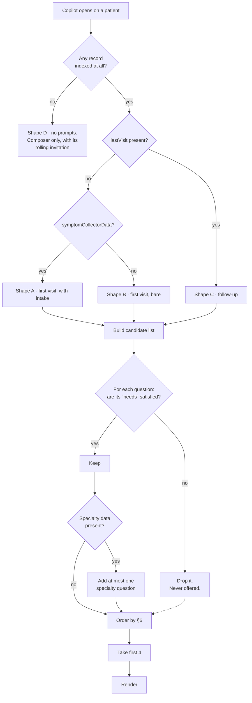

# Dr. Copilot — how the four starter questions are chosen

What Copilot offers to be asked, before the doctor has asked anything.

Four questions sit on the welcome screen. This document is the logic that
picks them: which signals are read, which questions exist, and the order they
are chosen in.

---

## 1. The rule everything else serves

> **Never offer a question this patient has no data to answer.**

A starter prompt is a promise. The doctor presses it because Copilot appeared
to know the answer was there, and an empty reply does not read as "no data" —
it reads as "this does not work". One dead end is enough to stop a doctor
pressing the second one.

This is not hypothetical. Running the current archive:

| Question | Citations returned | Usable? |
|---|---|---|
| What medications were recorded? | 3 `MedicationRequest` | ✅ |
| What conditions are recorded? | 2 `Condition` | ✅ |
| What was the latest recorded blood pressure? | 2 `Observation` | ✅ |
| What advice was given? | 4 incl. `Composition` | ✅ |
| What changed across recent records? | 1 `Composition` | ✅ |
| **What lab results are on file?** | **0** | ❌ dead end |
| **Any drug reaction documented?** | 2, both `StructuredQuery` | ❌ dead end |

Two of seven were dead ends, and both were on the welcome screen. The gate
below exists so that stops happening by construction rather than by noticing.

**A second gate: every starter question must be a lookup.** Chart Search is a
query engine over what the practice already stores. It fetches prescriptions,
vitals, labs, conditions and consultation notes; it does not reason across
them. *What changed across recent records?* returns a citation, so the table
above marks it usable, and it was on the welcome screen for that reason. It
should not have been: "what changed" asks for a comparison between two visits,
and a comparison is a conclusion. The engine hands back the record, not the
delta.

The doctor can still type that question. What Copilot must not do is
**volunteer** it, because a starter question is a promise about the kind of
answer that comes back. Every question in the pool below is therefore of the
form *show me / what is recorded*, never *what changed / is this better / what
should I do*.

A second finding from the same run: **wording is not cosmetic.** "What was
advised at the last visit?" retrieves nothing; "What advice was given?"
retrieves four records. Every `ask` string in the pool has been run against
the index. Changing one is a retrieval change, not a copy change.

---

## 2. Signals available today

Read at the moment the panel opens. Everything here already exists; nothing
below needs new plumbing except where marked.

### From the patient summary (`summary`)

| Signal | Means |
|---|---|
| `symptomCollectorData` | Patient filled the intake form before this visit |
| `todayVitals` | Vitals recorded at today's visit |
| `activeMeds` | Medication currently on the list |
| `keyLabs` / `labFlagCount` | Lab values, and how many are flagged |
| `chronicConditions` | Problem list |
| `allergies` | Structured allergy list |
| `lastVisit` | A previous visit exists → this is a follow-up |
| `specialtyTags`, `obstetricData`, `gynecData`, `pediatricsData`, `ophthalData` | Specialty context |

### From the page

| Signal | Means |
|---|---|
| `patientDocuments` | Uploaded reports / scans on file |
| `activeSpecialty` | The doctor's current specialty tab |

### From the archive (`retrieval`)

| Signal | Means |
|---|---|
| `record_presence.has_records` | Anything indexed for this patient at all |
| `sections[]` | Which resource kinds came back |

> **The one gap.** The archive does not yet report *which* resource kinds a
> patient has without being asked a question. Until it does, the gate falls
> back to the summary signals above, which is why `requires` in
> `starterPrompts.js` is currently called with `null`. One field —
> `available_kinds: ["MedicationRequest", "Observation", …]` on the patient
> or on `/ready` — closes it, and the gate switches on with no redesign.

---

## 3. The question pool

Generic on purpose. Each one pulls from a prescription or a medical record and
nothing cleverer, because that is what Copilot can actually do today.

Every question carries **two strings**:

- **`short`** — what the chip shows. **Six words maximum**, so it holds one
  line and reads as one thing to press.
- **`ask`** — what is sent. The full question, phrased exactly as it was run
  against the index.

They are separate on purpose. Shortening the sent query changes what the
archive retrieves, and the doctor sees the full question anyway the moment it
lands in the thread as their own message. Never send the short form.

`needs` is the gate. `intent` drives the card's icon and lead-in.

**How a chip is worded.** Four to six words, never fewer than three. Two-word
chips name a section of the chart rather than a question, and four of them
together read as a menu of areas instead of four things a doctor might want to
know: "Every medication on record", not "Medication list". The extra words are
what turn a label back into an offer.

They still have to be honest. A chip is a promise about what comes back, so
"Flagged lab results" stays out until there are stored ranges to flag against.

| # | Chip (`short`) | Sends (`ask`) | Needs | Intent | Verified |
|---|---|---|---|---|---|
| Q1 | Every medication on record | What medications were recorded? | `activeMeds` \| `MedicationRequest` | medications | ✅ |
| Q2 | Conditions on the problem list | What conditions are recorded? | `chronicConditions` \| `Condition` | diagnosis | ✅ |
| Q3 | Latest blood pressure reading | What was the latest recorded blood pressure? | `todayVitals` \| vital `Observation` | vitals | ✅ |
| Q4 | Advice given at last visit | What advice was given? | `Composition` | advice | ✅ |
| Q5 | Last prescription in full | Show me the last prescription | `Composition` | medications | ✅ |
| Q6 | What the patient reported | What did the patient report before this visit? | `symptomCollectorData` | intake | ⚠️ untested |
| Q7 | What the last visit recorded | What was recorded at the last visit? | `lastVisit` | history | ⚠️ untested |
| Q8 | Reports and scans on file | What reports are on file? | `patientDocuments.length` | documents | ⚠️ untested |
| Q9 | Lab results on file | What lab results are on file? | `keyLabs` \| lab `Observation` | labs | ❌ no data today |
| Q10 | Any documented drug reactions | Any drug reaction documented? | `allergies` | allergy | ❌ no data today |
| Q11 | What was prescribed last visit | What was prescribed at the last visit? | `lastVisit` **and** `MedicationRequest` | medications | ⚠️ untested |
| Q12 | Investigations advised at last visit | What investigations were advised? | `Composition` | labs | ⚠️ untested |

**Specialty additions** — offered only when the matching data is present, and
never more than one at a time:

| # | Chip | Sends | Needs |
|---|---|---|---|
| Q13 | Obstetric history | What does the obstetric history show? | `obstetricData` |
| Q14 | Gynec history | What does the gynec history show? | `gynecData` |
| Q15 | Growth and vaccination | What do growth and vaccination show? | `pediatricsData` |
| Q16 | Vision record | What does the vision record show? | `ophthalData` |

Anything marked ⚠️ must be run against the index before it goes on the welcome
screen. Anything marked ❌ stays out of the pool until the data exists.

---

## 4. Patient shapes

Four, and they differ in what is knowable rather than in what is interesting.

| Shape | Test | What exists |
|---|---|---|
| **A · First visit, with intake** | no `lastVisit`, has `symptomCollectorData` | Only what the patient typed, plus anything recorded today |
| **B · First visit, no intake** | no `lastVisit`, no `symptomCollectorData` | Almost nothing. Today's vitals at best |
| **C · Follow-up** | has `lastVisit` | Prescriptions, conditions, advice, and a comparison across visits |
| **D · Empty** | `has_records` false | Nothing. No starter questions at all |

Shape B is the one that goes wrong quietly: the panel looks the same as
shape C and every question dead-ends. It gets the fewest prompts, and if
nothing qualifies it gets none.

---

## 5. The logic tree



---

## 6. Ordering

Once the gate has run, order the survivors by what a doctor opens a chart to
find out, most common first:

1. **Q6** — what the patient reported (only shape A; it is the newest thing on
   the chart and the reason the visit is happening)
2. **Q1** — medications
3. **Q2** — conditions
4. **Q5** — the last prescription in full (only shape C)
5. **Q3** — latest vitals
6. **Q4** — advice
7. **Q7 / Q11** — last visit detail
8. **Q13–Q16** — specialty, at most one
9. **Q8, Q12** — documents, investigations

Take the first four. Fewer than four is a valid outcome; padding with a
question that dead-ends is not.

---

## 7. Worked examples

**Shape C, the common case.** Follow-up, meds and conditions on file, vitals
today, two visits.

Gate passes Q1, Q2, Q3, Q4, Q5. Order → Q1, Q2, Q5, Q3. The chips read:

```
Every medication on record      Conditions on the problem list
Last prescription in full       Latest blood pressure reading
```

Pressing the first sends *"What medications were recorded?"*, and that is what
appears in the thread as the doctor's message.

**Shape A.** First visit, patient filled intake, vitals taken at reception,
nothing else.

Gate drops Q1, Q2, Q4, Q5 (no prescriptions, no conditions, no note, no prior
visit). Survivors: Q6, Q3. Render **two**:

```
Reported symptoms         Latest blood pressure
```

Two honest prompts beat four where two are traps.

**Shape B.** First visit, no intake, nothing recorded yet.

Nothing passes the gate. Render **none** — the greeting and the composer, with
its rolling invitation, are the whole welcome screen. The doctor can still ask
anything; Copilot simply does not pretend to have suggestions.

**Shape D.** Not indexed. Same as B, and the first question asked returns the
"nothing indexed for this patient" reply rather than a card.

---

## 8. Where this lives

| Piece | File |
|---|---|
| Pool, `needs`, ordering, cap | `src/components/dr-copilot/chart-search/starterPrompts.js` |
| Signal read + call site | `src/components/dr-copilot/surfaces/CopilotDock.jsx` |
| Rendering | `src/components/dr-copilot/chat/WelcomeScreen.jsx` |

`pickStarterPrompts(availableKinds)` is the gate, and it is written. It is
called with `null` today, which means every prompt passes and order alone
decides — the behaviour before this document. Passing a real list switches the
gate on.

---

## 9. To do

0. Keep every `short` at six words or fewer. A chip that wraps stops reading
   as one thing to press, which is the whole reason the field exists.
1. Run Q6, Q7, Q8, Q11, Q12 against the index. Promote what returns citations;
   drop what does not.
2. Ask the archive for `available_kinds` per patient (§2), then pass it to
   `pickStarterPrompts` instead of `null`.
3. Wire the summary signals (`symptomCollectorData`, `lastVisit`,
   `todayVitals`, `patientDocuments`) into the gate — they are already on the
   panel and need only be read.
4. Re-run the whole pool against the index whenever the archive's retrieval
   changes. A prompt that worked last month is not evidence it works now.
