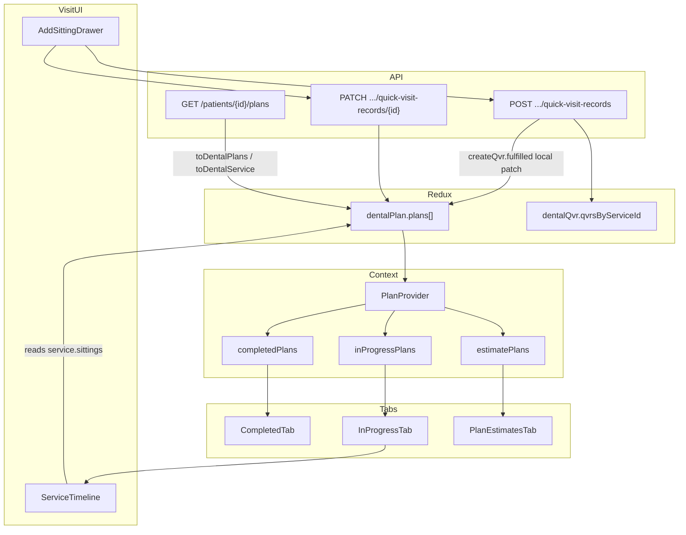

# Treatment Plan — Sittings / Quick Visit Records Data Flow Analysis

> **Purpose:** Document how plan data flows into the three tabs today, why sittings from the Plans API are not rendering, and a proposed plan to fix rendering + refetch-after-visit.

---

## 1. Entry Points

The treatment plan UI is mounted in two places:

| Entry | File | Notes |
|-------|------|-------|
| Standalone page | `TreatmentPlanPage.jsx` | Full page with back header; reads `patientId` from URL |
| Patient shell embed | `TreatmentPlanEmbed` in same file | Banner + card; used inside patient detail |

Both render **`TreatmentPlanTab`**, which wraps everything in **`PlanProvider`**.

```
TreatmentPlanPage / TreatmentPlanEmbed
        │
        ▼
  TreatmentPlanTab
        │
        ├── PlanProvider (patientId, initialDrawer, embedInPatientShell)
        │       │
        │       └── useDentalPlan(patientId)  →  Redux dentalPlan slice
        │
        └── TreatmentPlanInner
                ├── Tab pills (estimates / progress / completed)
                ├── Tab body (one of 3 tab components)
                └── Drawers (AddSittingDrawer, BookAppointment, etc.)
```

**Note:** `TreatmentPlanPage` still imports `getMockPlans` for **deep-link drawer bootstrapping only** (`?drawer=add-sitting`). Runtime plan data comes from Redux, not mock data.

---

## 2. Central Data Layer

### 2.1 `useDentalPlan` → Redux

**File:** `src/components/dental/lib/useDentalPlan.js`

| Event | Action |
|-------|--------|
| Mount / `patientId` change | `dispatch(fetchDentalPlans(patientId))` |
| CRUD on plans/services | Individual thunks (`createDentalPlan`, `updatePlanService`, etc.) |
| Activate plan | `activateDentalPlan` then **refetches** `fetchDentalPlans` |

**Redux store:** `state.dentalPlan.plans` — single array for the patient.

**API:** `GET /api/v1/dental/patients/{patientId}/plans` → mapped via `toDentalPlans()` → `toDentalPlan()` → `toDentalService()` per service.

### 2.2 `PlanProvider` → React Context

**File:** `src/components/dental/plan/plan-context.jsx`

Reads `plans` from `useDentalPlan` and exposes:

| Context value | Derivation |
|---------------|------------|
| `estimatePlans` | `plans.filter(p => p.status === "draft")` |
| `inProgressPlans` | `plans.filter(p => p.status === "active" \|\| p.status === "in-progress")` |
| `completedPlans` | `plans.filter(p => p.status === "completed")` |
| `findService(serviceId)` | Linear search across all plans' `services` |
| `findPlanForService(serviceId)` | Plan containing that service |
| `updateService`, `openDrawer`, etc. | Pass-through from hook + local UI state |

**Important:** All three tabs read from the **same** `plans` array in Redux. Tab components do **not** fetch their own data — they only filter by plan `status`.

### 2.3 API → UI mapping (`toDentalService`)

**File:** `src/utils/dentalApiMappers.js`

Plans API returns services with a **`sittings`** array (quick visit records embedded):

```json
{
  "id": "svc-...",
  "treatment": "RTC",
  "sittings": [
    {
      "id": "sit-...",
      "visitDate": "2026-06-26",
      "visitTime": "12:04:00",
      "doctorId": "618",
      "visitType": "FOLLOW_UP",
      "notes": "...",
      "status": "COMPLETED"
    }
  ]
}
```

**Current mapper logic (problem):**

```js
sittings: (service.quickVisitRecords || service.quick_visit_records || [])
  .map((qvr) => qvrToSitting(toDentalQvr(qvr)))
```

The mapper looks for `quickVisitRecords`, **not** `sittings`. Because the API sends `sittings`, the mapped result is **`[]`**, and the spread `...service` sittings field is **overwritten** with an empty array.

**This is the primary reason the Active Plans tab shows "No visits recorded yet" even when the API has visits.**

---

## 3. Tab-by-Tab Flow

### 3.1 Plan Estimates Tab

**File:** `PlanEstimatesTab.jsx`  
**Data:** `estimatePlans` from context (`status === "draft"`)

```
estimatePlans
    └── PlanSubCard (accordion per plan)
            └── Services table (treatment, tooth, surfaces, rate, amount)
            └── Actions: Activate, Edit, Duplicate, Delete, Bill preview
```

| Aspect | Behavior |
|--------|----------|
| Sittings rendered? | **No** — estimates only show service line items |
| Visit timeline? | **No** |
| Add visit drawer? | **No** (drawer exists globally but not surfaced here) |

**Relevance to requirement:** When plans are refetched after a visit, draft plans would automatically get updated `sittings` on their services (once mapper is fixed). No UI change needed unless we want to preview visits on estimates.

---

### 3.2 Active Plans Tab (In Progress)

**File:** `InProgressTab.jsx`  
**Data:** `inProgressPlans` from context (`status === "active"` or `"in-progress"`)

API status `ACTIVE` → mapped to `"active"` → appears in this tab.

```
inProgressPlans
    └── PlanClusterCard (per plan)
            └── ServiceSubCard (accordion per service)
                    ├── Header: treatment, tooth pill, status dropdown, ServiceActions
                    └── [expanded] ServiceAppointmentSection
                            ├── Summary row (treatment, tooth, surfaces, amount, notes)
                            └── ServiceTimeline  ← sittings render here
```

**Sittings rendering chain:**

```
service.sittings
    → ServiceTimeline.buildVisitTimelineEntries()
    → entry.kind === "sitting"
    → visit row UI (doctor, date, visit type, notes, edit/delete actions)
```

**Empty state:** If `service.sittings` is empty, `ServiceTimeline` shows "No visits recorded yet" + "Add Quick Visit Report" button.

| Aspect | Behavior |
|--------|----------|
| Sittings source | `service.sittings` on Redux plan object |
| Timeline also shows | `service.appointments`, `service.consultations` (local/mock; not fully API-wired) |
| Add visit | `openDrawer({ type: "add-sitting", serviceId })` → `AddSittingDrawer` |
| Edit visit | `openDrawer({ type: "edit-sitting", serviceId, sittingId })` |

---

### 3.3 Completed Tab

**File:** `CompletedTab.jsx`  
**Data:** `completedPlans` from context (`status === "completed"`)

```
completedPlans
    └── CompletedPlanSubCard
            └── Table: CompletedServiceRow per service
                    (treatment, tooth, completedAt, status chip, amount, Rx/Bill actions)
```

| Aspect | Behavior |
|--------|----------|
| Sittings rendered? | **No** — table summary only |
| Visit timeline? | **No** |
| Uses `service.sittings`? | Only indirectly via `getServiceWorkflowStatus()` (counts sittings for "in-progress" chip) |

**Relevance to requirement:** Refetched plan data would update workflow status chips if sittings exist, but there is no per-visit list on this tab today.

---

## 4. Add / Edit Visit Flow (Current)

```
User clicks "Add Quick Visit Report"
        │
        ▼
openDrawer({ type: "add-sitting", serviceId })
        │
        ▼
AddSittingDrawer
        ├── findService(serviceId)     ← from context / Redux plans
        ├── findPlanForService(serviceId)
        └── handleAdd()
                │
                ▼
        dispatch(createQvr({ patientId, planId, serviceId, data }))
                │
                ▼
        POST .../services/{serviceId}/quick-visit-records   ✅ correct endpoint
                │
                ▼
        createQvr.fulfilled
                ├── dentalQvrSlice: qvrsByServiceId[serviceId].push(qvr)
                └── dentalPlanSlice: manually push to service.sittings + quickVisitRecords
```

**Edit flow:** Same pattern with `updateQvr` → `PATCH .../quick-visit-records/{qvrId}`.

### 4.1 What does NOT happen today

| Missing step | Impact |
|--------------|--------|
| **No `fetchDentalPlans` after create/update QVR** | UI relies on optimistic local patch in `dentalPlanSlice`; won't match server if response shape differs or other fields change |
| **Mapper ignores API `sittings` on initial load** | Visits from GET plans never appear |
| **createQvr response may omit `notes`** (per sample) | Local patch may have incomplete sitting until refetch |

### 4.2 Legacy wrong path (fixed in code, worth noting)

Previously, add visit called `updateService(planId, serviceId, { sittings: [...] })`, which triggered:

```
PATCH .../services/{serviceId}
Body: { "surfaces": ["whole"], "teeth": ["full-mouth"] }   ← wrong
```

That path has been removed from `AddSittingDrawer`. `ServiceTimeline` sitting delete/revert was also moved to `deleteQvr` / `updateQvr`.

---

## 5. Data Shape Reference

### API service `sittings[]` (from Plans GET)

| Field | Example |
|-------|---------|
| `id` | `sit-7d34b870-...` |
| `visitDate` | `2026-06-26` |
| `visitTime` | `12:04:00` |
| `doctorId` | `618` |
| `visitType` | `FOLLOW_UP` |
| `notes` | string |
| `status` | `COMPLETED` |
| `version` | `1` |

### UI `service.sittings[]` (timeline format via `qvrToSitting`)

| Field | Example |
|-------|---------|
| `id` | same as API |
| `date` | `26 Jun 2026, 12:04 PM` (display label) |
| `time` | `12:04 PM` |
| `doctor` | display name (often empty unless `doctorName` passed) |
| `visitType` | `FOLLOW_UP` |
| `visitDate` / `visitTime` | raw API values (for edit form) |
| `notes`, `status`, `version`, `doctorId` | preserved |

---

## 6. Architecture Diagram (End-to-End)



---

## 7. Root Cause Summary

| # | Issue | Symptom |
|---|-------|---------|
| 1 | `toDentalService` maps `quickVisitRecords` only, not API `sittings` | Visits never appear after page load |
| 2 | No plan refetch after QVR create/update | Stale / partial data vs server |
| 3 | Sittings UI only on Active Plans tab | Estimates & Completed don't show visit lists (by design today) |
| 4 | `doctor` display name not in API sitting object | Timeline may show blank doctor unless resolved from `doctorId` |

---

## 8. Implementation Plan (For Review)

### Phase 1 — Fix mapper (unblocks rendering on load)

**File:** `src/utils/dentalApiMappers.js`

Update `toDentalService` to normalize sittings from all API shapes:

```js
const rawVisits =
  service.sittings ||
  service.quickVisitRecords ||
  service.quick_visit_records ||
  [];

const normalizedQvrs = rawVisits.map(toDentalQvr);

return {
  ...service,
  // ...
  quickVisitRecords: normalizedQvrs,
  sittings: normalizedQvrs.map((qvr) => qvrToSitting(qvr)),
};
```

**Acceptance:** Loading patient with the sample API response shows the RTC sitting in Active Plans → ServiceTimeline.

---

### Phase 2 — Refetch plans after visit mutations

**Files:**
- `src/components/dental/lib/useDentalPlan.js` — expose `refetchPlans()`
- `src/redux/dentalQvrSlice.js` or `AddSittingDrawer.jsx` — after successful create/update/delete QVR, call `fetchDentalPlans(patientId)`

**Recommended approach:** Refetch in `useDentalPlan` via a wrapper or in `dentalPlanSlice` extraReducer listening to `createQvr.fulfilled` / `updateQvr.fulfilled` / `deleteQvr.fulfilled` (same pattern as `activatePlan`).

```js
// After QVR mutation succeeds:
dispatch(fetchDentalPlans(patientId));
```

**Remove or simplify** optimistic `createQvr.fulfilled` / `updateQvr.fulfilled` patches in `dentalPlanSlice` once refetch is reliable (or keep as instant UI, let refetch reconcile).

**Acceptance:** After "Add visit", network shows POST QVR then GET plans; timeline matches server data including `notes`, `version`, etc.

---

### Phase 3 — Doctor display (optional polish)

Resolve `doctorId` → display name for timeline rows (from `state.doctors.profile` or a clinic doctors list).

**Acceptance:** Sitting row shows doctor name instead of "Quick visit" fallback.

---

### Phase 4 — Tab coverage (scope decision)

| Tab | Recommendation |
|-----|----------------|
| **Active Plans** | Already renders sittings via `ServiceTimeline` — Phase 1 + 2 sufficient |
| **Plan Estimates** | No visit UI today; refetch still updates shared Redux (no visible change unless we add timeline) |
| **Completed** | No visit UI today; `getServiceWorkflowStatus` will reflect sittings count after Phase 1 |

**For "pass same updated data to all tabs":** No extra work needed — all tabs already read from `state.dentalPlan.plans`. Fixing mapper + refetch updates every tab automatically.

If product wants visit lists on Completed tab later, reuse `ServiceAppointmentSection` + `ServiceTimeline` in `CompletedServiceRow` expand state (out of current scope).

---

### Phase 5 — Testing checklist

- [ ] Load plans: service with `sittings[]` in API appears in Active Plans timeline
- [ ] Add visit: POST QVR + GET plans refetch; new sitting visible without page reload
- [ ] Edit visit: PATCH QVR + GET plans; changes reflected
- [ ] Delete / revert sitting: DELETE or PATCH QVR + GET plans
- [ ] Switch tabs after add: Estimates / Completed counts and statuses consistent
- [ ] No `PATCH /services/{id}` with only `{ surfaces, teeth }` on add visit

---

## 9. Files Touched (Estimated)

| File | Change |
|------|--------|
| `src/utils/dentalApiMappers.js` | Read `sittings` from API; normalize to timeline format |
| `src/components/dental/lib/useDentalPlan.js` | Expose `refetchPlans` |
| `src/components/dental/plan/AddSittingDrawer.jsx` | Call refetch after create/update success |
| `src/components/dental/plan/ServiceTimeline.jsx` | Call refetch after delete/revert QVR (optional if centralized) |
| `src/redux/dentalPlanSlice.js` | Optional: trigger refetch from QVR fulfilled; trim optimistic patch |
| `src/components/dental/plan/plan-context.jsx` | Expose `refetchPlans` if drawers don't use dispatch directly |

**No changes required to** `TreatmentPlanTab.jsx` tab switching logic — tabs already consume shared context.

---

## 10. Open Questions for Product / Review

1. Should **Completed** and **Estimates** tabs show a visit timeline, or is Active Plans sufficient?
2. After refetch, should we **remove** optimistic local QVR patches to avoid double-updates?
3. Should `doctorId` in sitting rows resolve from a clinic doctor list API, or is logged-in doctor name enough for now?

---

*Generated for review before implementing sittings render + plan refetch integration.*
